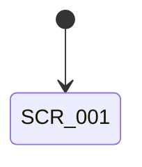

<!-- TEMPLATE -->
<!-- このマーカー行は、内容を記入し始めたら削除する -->
# UI 設計書

| 項目 | 内容 |
|---|---|
| バージョン | 0.1 |
| 状態 | DRAFT / IN_REVIEW / APPROVED |
| 入力 | requirements.md v_ |

## 1. デザイン方針
<!-- Material 3、ダイナミックカラー対応有無、ダークテーマ、片手操作、フォントスケール対応など -->

## 2. 画面一覧
| ID | 画面名 | 目的 | 関連要件 |
|---|---|---|---|
| **SCR-001** |  |  | REQ-001 |

## 3. 画面遷移

## 4. 画面詳細
### SCR-001 <画面名>
- **レイアウト概要**: <!-- 主要要素と配置。ワイヤーフレーム画像があれば ./img/ に置いてリンク -->
- **UI 状態**:

| 状態 | 表示 | 可能な操作 |
|---|---|---|
|  |  |  |

- **ユーザー操作 → 結果**:

| 操作 | 結果 | 関連要件 |
|---|---|---|

- **Preview / スクリーンショット**: `@Preview` 関数名と Roborazzi 画像 `app/src/test/screenshots/...png`
- **アクセシビリティ**: contentDescription、フォーカス順、最小タッチ領域
- **testTag**: <!-- テストで使うタグ名 -->

## 5. 共通コンポーネント
| 名前 | 用途 | 使用画面 |
|---|---|---|

## 6. 未決事項
| ID | 質問 | 回答 | 状態 |
|---|---|---|---|

## 7. 変更履歴
| 日付 | 版 | 内容 |
|---|---|---|
