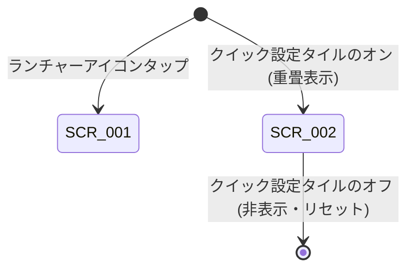

# UI 設計書

| 項目 | 内容 |
|---|---|
| バージョン | 1.0 |
| 状態 | IN_REVIEW |
| 入力 | requirements.md v1.0 |

## 1. デザイン方針
- Material 3 ガイドラインに準拠し、ダイナミックカラーに対応（Android 12+）。
- ストップウォッチ UI は、他アプリの邪魔を最小限に抑えつつ視認性を確保するため、72dp の円形 FAB サイズとする（REQ-004）。
- 背景色・タイポグラフィで状態（待機・計測中・一時停止中・上限）を一目で識別可能にする（REQ-013）。
- 拡大フォント（Accessibility Large Font）環境でも数字が円からはみ出ないよう dp ベースのフォントスケーリング制限を行い、代わりに TalkBack などのスクリーンリーダーで状態と経過時間を完全に提供する（NFR-003）。
- 日本語・英語に完全対応（NFR-007）。

## 2. 画面一覧
| ID | 画面名 | 目的 | 関連要件 |
|---|---|---|---|
| **SCR-001** | 使い方説明画面 (UsageScreen) | ランチャーアイコンから起動され、クイック設定タイルの追加方法や権限の許可、基本的な使い方を案内する | REQ-017 |
| **SCR-002** | フローティングストップウォッチ (FloatingStopwatch) | 他アプリの上に常駐・重畳表示され、タップで開始/一時停止、ドラッグで移動、現在の経過時間を mm:ss で表示する | REQ-001, REQ-002, REQ-004, REQ-005, REQ-006, REQ-007, REQ-008, REQ-009, REQ-010, REQ-011, REQ-012, REQ-013, REQ-014, REQ-015, REQ-016 |

## 3. 画面遷移

## 4. 画面詳細

### SCR-001 使い方説明画面 (UsageScreen)
- **レイアウト概要**:
  - 全画面スクロール可能な Column。
  - ヘッダー（タイトル・要約説明）。
  - 4 ステップの手順カード（(1) タイル追加、(2) 権限許可、(3) 表示・非表示切り替え、(4) ストップウォッチ操作）。
  - フッター注記（ロック画面での挙動・画面消灯時の動作）。
- **UI 状態**:
  - 静的説明画面（状態なし）。
- **ユーザー操作 → 結果**:

| 操作 | 結果 | 関連要件 |
|---|---|---|
| スクロール | 画面内容が上下にスクロール | REQ-017 |

- **Preview / スクリーンショット**:
  - `UsageScreenPreview` -> `app/src/test/screenshots/com.puzzroom.quickstopwatch.ui.usage.UsageScreenKt.UsageScreenPreview.W360dp_H800dp_WITH_BACKGROUND.png`
  - `UsageScreenJapanesePreview` -> `app/src/test/screenshots/com.puzzroom.quickstopwatch.ui.usage.UsageScreenKt.UsageScreenJapanesePreview.W360dp_H800dp_ja_WITH_BACKGROUND.png`
  - `UsageScreenLargeFontPreview` -> `app/src/test/screenshots/com.puzzroom.quickstopwatch.ui.usage.UsageScreenKt.UsageScreenLargeFontPreview.W360dp_H1400dp_FONT_1_6f_WITH_BACKGROUND.png`
- **アクセシビリティ**: 各カードに番号とタイトル・本文がセマンティクスとして設定され、TalkBack で自然に読み上げられる。
- **testTag**:
  - ルート: `usage_screen`
  - 各ステップ: `usage_step_1`, `usage_step_2`, `usage_step_3`, `usage_step_4`

---

### SCR-002 フローティングストップウォッチ (FloatingStopwatch)
- **レイアウト概要**:
  - 72dp × 72dp の円形コンポーネント。
  - 中央に経過時間テキスト（等幅数字フォント `tnum` 指定）。
  - 状態に応じた Material 3 カラー配色（枠線 1dp outline）。
- **UI 状態**:

| 状態 | 表示 / 配色 | 可能な操作 |
|---|---|---|
| **待機 (Idle)** | `00:00` / `secondaryContainer` (控えめな背景) | タップ（開始）、ドラッグ（移動） |
| **計測中 (Running)** | `mm:ss` (毎秒更新) / `primary` (目立つ強調色) | タップ（一時停止）、ドラッグ（移動） |
| **一時停止中 (Paused)** | `mm:ss` (固定) / `tertiaryContainer` (注意色) | タップ（再開）、ドラッグ（移動） |
| **上限 (Limit)** | `999:59` (固定) / `tertiaryContainer` | ドラッグ（移動のみ。タップは無視） |

- **ユーザー操作 → 結果**:

| 操作 | 結果 | 関連要件 |
|---|---|---|
| タップ (Idle) | 計測開始（Running へ遷移）、触覚フィードバック | REQ-005, REQ-014 |
| タップ (Running) | 一時停止（Paused へ遷移）、触覚フィードバック | REQ-005, REQ-014 |
| タップ (Paused) | 計測再開（Running へ遷移）、触覚フィードバック | REQ-005, REQ-014 |
| タップ (Limit) | 変化なし（触覚フィードバックなし） | REQ-007 |
| ドラッグ | 移動量に応じてウィンドウ座標が更新され指に追従 | REQ-011 |
| ドラッグ終了 | 最終座標を DataStore に保存 | REQ-012 |

- **Preview / スクリーンショット**:
  - `FloatingStopwatchIdlePreview` -> `app/src/test/screenshots/com.puzzroom.quickstopwatch.ui.floating.FloatingStopwatchKt.FloatingStopwatchIdlePreview.W112dp_H112dp_WITH_BACKGROUND_BG_COLOR_4287269514.png`
  - `FloatingStopwatchRunningPreview` -> `app/src/test/screenshots/com.puzzroom.quickstopwatch.ui.floating.FloatingStopwatchKt.FloatingStopwatchRunningPreview.W112dp_H112dp_WITH_BACKGROUND_BG_COLOR_4287269514.png`
  - `FloatingStopwatchPausedPreview` -> `app/src/test/screenshots/com.puzzroom.quickstopwatch.ui.floating.FloatingStopwatchKt.FloatingStopwatchPausedPreview.W112dp_H112dp_WITH_BACKGROUND_BG_COLOR_4287269514.png`
  - `FloatingStopwatchThreeDigitMinutesPreview` -> `app/src/test/screenshots/com.puzzroom.quickstopwatch.ui.floating.FloatingStopwatchKt.FloatingStopwatchThreeDigitMinutesPreview.W112dp_H112dp_WITH_BACKGROUND_BG_COLOR_4287269514.png`
  - `FloatingStopwatchDarkLargeFontPreview` -> `app/src/test/screenshots/com.puzzroom.quickstopwatch.ui.floating.FloatingStopwatchKt.FloatingStopwatchDarkLargeFontPreview.W112dp_H112dp_FONT_2_0f_WITH_BACKGROUND_BG_COLOR_4280295456_NIGHT.png`
- **アクセシビリティ**:
  - `contentDescription`: 「ストップウォッチ mm:ss」
  - `stateDescription`: 「待機中」「計測中」「一時停止中」「上限に到達」
  - `onClick`: アクションラベル（「開始」「一時停止」「再開」）を提供し、TalkBack アクションメニューやダブルタップに対応。
  - タッチターゲットは 72dp × 72dp でアクセシビリティ基準（48dp 以上）を満たす。
- **testTag**:
  - ルート: `floating_stopwatch`
  - 時刻表示部: `floating_stopwatch_time`

## 5. 共通コンポーネント
- 特になし（単一 FAB コンポーネントと Usage カードのみ）。

## 6. 未決事項
なし

## 7. 変更履歴
| 日付 | 版 | 内容 |
|---|---|---|
| 2026-10-12 | 1.0 | 初版作成（SCR-001, SCR-002 設計、Roborazzi 画像連携） |
