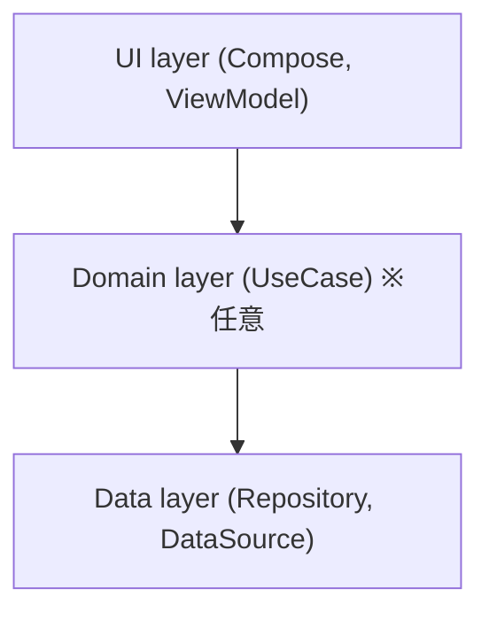

<!-- TEMPLATE -->
<!-- このマーカー行は、内容を記入し始めたら削除する -->
# アーキテクチャ設計書

| 項目 | 内容 |
|---|---|
| バージョン | 0.1 |
| 状態 | DRAFT / IN_REVIEW / APPROVED |
| 入力 | requirements.md v_, ui-design.md v_ |

## 1. アーキテクチャ方針
<!-- 公式「アプリ アーキテクチャ ガイド」に準拠するか、逸脱点とその理由。`android docs search "app architecture"` で確認 -->

## 2. レイヤ構成と依存方向

| レイヤ | 責務 | 主な型 | 依存してよい先 |
|---|---|---|---|

## 3. モジュール構成
<!-- 単一 :app のままか分割するか。分割するなら ADR を書く -->

## 4. 横断的関心事
| 関心事 | 方針 | ADR |
|---|---|---|
| 状態管理 | 例: UDF, StateFlow<UiState> |  |
| DI | 例: 手動 DI / Hilt |  |
| 永続化 | 例: DataStore / Room / なし |  |
| バックグラウンド処理 | 例: Foreground Service / WorkManager / なし |  |
| 時刻ソース | テストのため抽象化する |  |
| ナビゲーション | Navigation 3 |  |
| エラー処理 / ログ |  |  |

## 5. 要件との対応
| 要件 | 実現するコンポーネント |
|---|---|
| REQ-001 |  |

## 6. 主要な判断（ADR 一覧）
| ADR | タイトル | 状態 |
|---|---|---|

## 7. 未決事項
| ID | 質問 | 回答 | 状態 |
|---|---|---|---|

## 8. 変更履歴
| 日付 | 版 | 内容 |
|---|---|---|
