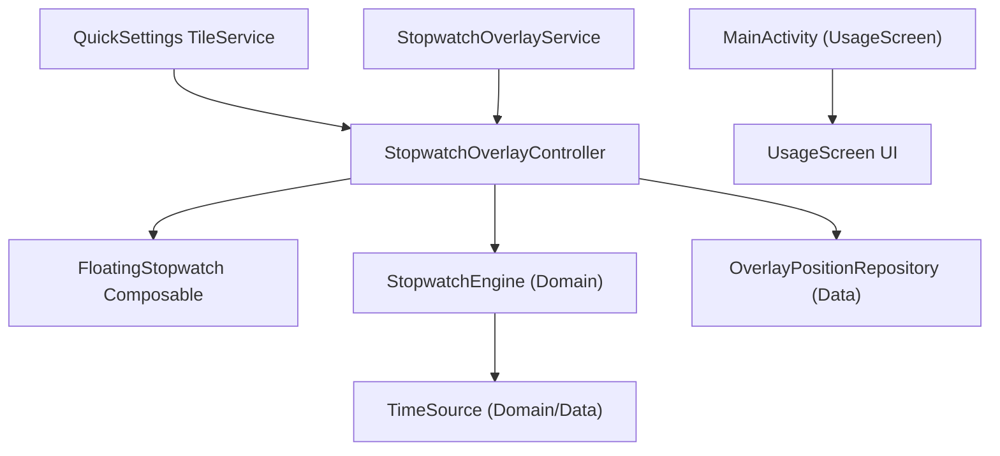

# アーキテクチャ設計書

| 項目 | 内容 |
|---|---|
| バージョン | 1.0 |
| 状態 | IN_REVIEW |
| 入力 | requirements.md v1.0, ui-design.md v1.0 |

## 1. アーキテクチャ方針
- Google 公式「アプリ アーキテクチャ ガイド」に準拠し、単方向データフロー (UDF) とレイヤ分離を採用。
- UI レイヤ、Domain レイヤ、Data レイヤの 3 層構成とし、DI はシンプルな手動ファクトリ/プロバイダで構成（モジュールが小さいため Hilt 等の重厚な DI フレームワークは不要）。
- 外部入出力（時刻、OS の WindowManager、TileService、設定永続化）をインターフェースで抽象化し、JVM 単体テストでの網羅的検証を可能にする。

## 2. レイヤ構成と依存方向

| レイヤ | 責務 | 主な型 | 依存してよい先 |
|---|---|---|---|
| **UI** | ユーザーへの表示とイベント受付 | `UsageScreen`, `FloatingStopwatch`, `StopwatchUiState` | Domain, Data (読み取りのみ) |
| **Service / Presentation** | Android システム連携（Tile, WindowManager, ライフサイクル） | `QuickStopWatchTileService`, `StopwatchOverlayService`, `StopwatchOverlayController` | UI, Domain, Data |
| **Domain** | ストップウォッチの状態遷移、経過時間計算、上限判定ロジック | `StopwatchEngine`, `StopwatchState`, `TimeSource` | なし (純粋 Kotlin) |
| **Data** | 座標などの永続化、システム時刻の具象実装 | `OverlayPositionRepository`, `SystemTimeSource` | Domain |

## 3. モジュール構成
- **単一 `:app` モジュール**を維持（詳細は [ADR-0001](file:///Users/isseikz/_projects/QuickStopWatch/docs/adr/0001-single-module.md) 参照）。

## 4. 横断的関心事
| 関心事 | 方針 | ADR |
|---|---|---|
| **状態管理** | UDF に準拠。`StopwatchEngine` が StateFlow でイミュータブルな状態を公開 | [ADR-0004](file:///Users/isseikz/_projects/QuickStopWatch/docs/adr/0004-time-source-and-state.md) |
| **オーバーレイ表示** | WindowManager + ComposeView。FLAG_KEEP_SCREEN_ON で画面常時オン | [ADR-0003](file:///Users/isseikz/_projects/QuickStopWatch/docs/adr/0003-compose-overlay-keep-screen-on.md) |
| **常駐・サービス** | FGS は使わず、アクティブなオーバーレイウィンドウ管理のみを行う | [ADR-0002](file:///Users/isseikz/_projects/QuickStopWatch/docs/adr/0002-no-fgs.md) |
| **DI** | 小規模構成のため Constructor Injection と Service 内での手動生成 | - |
| **永続化** | UI 座標の保存に SharedPreferences / DataStore を利用 | [ADR-0004](file:///Users/isseikz/_projects/QuickStopWatch/docs/adr/0004-time-source-and-state.md) |
| **時刻ソース** | `TimeSource` インターフェースにより抽象化。テスト時は `FakeTimeSource` | [ADR-0004](file:///Users/isseikz/_projects/QuickStopWatch/docs/adr/0004-time-source-and-state.md) |
| **ナビゲーション** | 単一画面のため Nav3 による MainEntry のみ | - |

## 5. 要件との対応
| 要件 | 実現するコンポーネント |
|---|---|
| REQ-001, REQ-004 | `StopwatchOverlayService`, `FloatingStopwatch` |
| REQ-002, REQ-003, REQ-018 | `QuickStopWatchTileService` |
| REQ-005, REQ-006, REQ-007, REQ-008 | `StopwatchEngine`, `TimeSource` |
| REQ-009, REQ-016 | `StopwatchOverlayController.hide()` でリセット実行 |
| REQ-010 | `WindowManager.LayoutParams.FLAG_KEEP_SCREEN_ON` |
| REQ-011, REQ-012 | `FloatingStopwatch`, `OverlayPositionRepository` |
| REQ-013, REQ-014 | `FloatingStopwatch` (M3 テーマ, HapticFeedback) |
| REQ-015 | `SystemClock.elapsedRealtime()` に基づく絶対時刻差分計算 |
| REQ-017 | `MainActivity`, `UsageScreen` |
| NFR-001 | マニフェスト設定 (`SYSTEM_ALERT_WINDOW` のみ) |
| NFR-002 | minSdk 31, targetSdk 36 設定 |
| NFR-003 | Compose semantics, 72dp タッチ領域 |
| NFR-004, NFR-006 | 1秒 Ticker Flow と `elapsedRealtime` |
| NFR-007 | `res/values`, `res/values-ja` |
| NFR-008 | ネットワーク不使用、ローカル座標のみ保存 |

## 6. 主要な判断（ADR 一覧）
| ADR | タイトル | 状態 |
|---|---|---|
| **ADR-0001** | 単一 :app モジュールの維持 | Accepted |
| **ADR-0002** | 前面サービス (FGS) を使用せず常駐を行わない設計 | Accepted |
| **ADR-0003** | Compose View を使ったオーバーレイと FLAG_KEEP_SCREEN_ON による常時オン | Accepted |
| **ADR-0004** | 状態管理・時刻計測モデルと SharedPreferences / DataStore | Accepted |

## 7. 未決事項
なし

## 8. 変更履歴
| 日付 | 版 | 内容 |
|---|---|---|
| 2026-10-12 | 1.0 | 初版作成（アーキテクチャ方針、レイヤ構成、ADR-0001〜ADR-0004 策定） |
