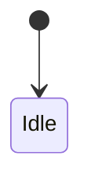

<!-- TEMPLATE -->
<!-- このマーカー行は、内容を記入し始めたら削除する -->
# 詳細設計書

| 項目 | 内容 |
|---|---|
| バージョン | 0.1 |
| 状態 | DRAFT / IN_REVIEW / APPROVED |
| 入力 | requirements.md v_, ui-design.md v_, architecture.md v_ |

## 1. パッケージ構成
```
com.puzzroom.quickstopwatch
├── ui/
├── domain/
└── data/
```

## 2. 設計要素
<!-- 1 要素 = 1 行。ID を太字で定義し、上流 ID を必ず参照 -->
| ID | 要素（クラス/関数/状態機械） | 責務 | 上流 |
|---|---|---|---|
| **DD-001** |  |  | REQ-001, SCR-001 |

## 3. 要素詳細
### DD-001 <名前>
- **公開 IF**:
```kotlin
// シグネチャを書く
```
- **状態遷移**（ある場合）:

- **事前条件 / 事後条件 / 不変条件**:
- **エラー・境界値**:
- **非決定要素の注入**（時刻・Dispatcher 等）:

## 4. UiState / イベント定義
| 画面 | UiState | UI イベント | 上流 |
|---|---|---|---|

## 5. データ定義（永続化がある場合）
| 名前 | 型 | 既定値 | 保存先 |
|---|---|---|---|

## 6. 未決事項
| ID | 質問 | 回答 | 状態 |
|---|---|---|---|

## 7. 変更履歴
| 日付 | 版 | 内容 |
|---|---|---|
