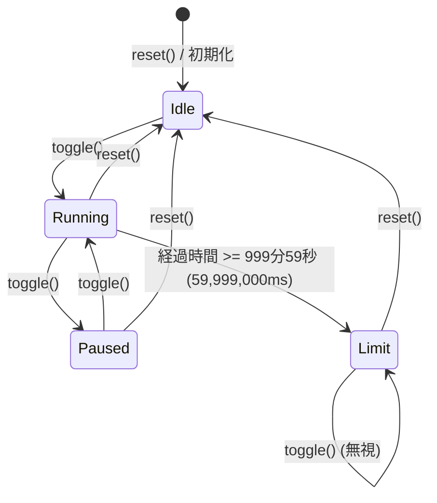

# 詳細設計書

| 項目 | 内容 |
|---|---|
| バージョン | 1.0 |
| 状態 | IN_REVIEW |
| 入力 | requirements.md v1.0, ui-design.md v1.0, architecture.md v1.0 |

## 1. パッケージ構成
```
com.puzzroom.quickstopwatch
├── domain/
│   ├── TimeSource.kt
│   └── StopwatchEngine.kt
├── data/
│   ├── SystemTimeSource.kt
│   └── OverlayPositionRepository.kt
├── service/
│   ├── QuickStopWatchTileService.kt
│   ├── StopwatchOverlayService.kt
│   └── StopwatchOverlayController.kt
└── ui/
    ├── floating/
    │   └── FloatingStopwatch.kt
    └── usage/
        └── UsageScreen.kt
```

## 2. 設計要素
| ID | 要素（クラス/関数/状態機械） | 責務 | 上流 |
|---|---|---|---|
| **DD-001** | `TimeSource` (Interface) | 端末起動からの経過時間（ミリ秒）を取得する抽象インターフェース | REQ-008, NFR-004 |
| **DD-002** | `SystemTimeSource` (Class) | `SystemClock.elapsedRealtime()` を返す本番実装 | REQ-008, DD-001 |
| **DD-003** | `StopwatchEngine` (Class) | 待機・計測・一時停止・上限のステートマシンと経過時間・表示文字列生成 | REQ-005, REQ-006, REQ-007, REQ-008, REQ-009, REQ-013, NFR-004, NFR-006 |
| **DD-004** | `OverlayPositionRepository` (Class) | フローティング UI の表示座標 (x, y) の保存・取得・初期配置計算 | REQ-011, REQ-012, NFR-008 |
| **DD-005** | `FloatingStopwatch` (Composable) | 72dp 円形 UI の描画、状態別配色、タップ・ドラッグ検知、アクセシビリティ | REQ-004, REQ-005, REQ-011, REQ-013, REQ-014, NFR-003, SCR-002 |
| **DD-006** | `StopwatchOverlayController` (Class) | WindowManager への ComposeView 追加・削除、画面常時オンフラグ管理、位置更新 | REQ-001, REQ-004, REQ-009, REQ-010, REQ-011, REQ-012, REQ-016 |
| **DD-007** | `QuickStopWatchTileService` (TileService) | クイック設定タイルのタップ受付、権限確認・設定誘導、サービスの開始/停止 | REQ-002, REQ-003, REQ-016, REQ-018 |
| **DD-008** | `StopwatchOverlayService` (Service) | バックグラウンドでのオーバーレイ UI のライフサイクル保持、プロセス終了時の安全なクリーンアップ | REQ-001, REQ-002, REQ-016 |
| **DD-009** | `UsageScreen` (Composable) | アプリ起動時に表示される使い方説明画面 | REQ-017, SCR-001 |

## 3. 要素詳細

### DD-001 TimeSource & DD-002 SystemTimeSource
- **公開 IF**:
```kotlin
interface TimeSource {
  fun elapsedRealtimeMillis(): Long
}

class SystemTimeSource : TimeSource {
  override fun elapsedRealtimeMillis(): Long = SystemClock.elapsedRealtime()
}
```

---

### DD-003 StopwatchEngine
- **公開 IF**:
```kotlin
class StopwatchEngine(
  private val timeSource: TimeSource = SystemTimeSource(),
  private val coroutineScope: CoroutineScope,
) {
  val uiState: StateFlow<StopwatchUiState>

  fun toggle()
  fun reset()
}
```
- **状態遷移**:

- **経過時間と表示文字列計算**:
  - `totalElapsedMillis = accumulatedMillis + if (isRunning) (currentTime - startBaseTime) else 0L`
  - 秒数 `totalSeconds = totalElapsedMillis / 1000`
  - 999分59秒（`59999秒`）以上の場合は `59999秒` にクリップし、モードを `Limit` に遷移。
  - 分 `minutes = totalSeconds / 60`
  - 秒 `seconds = totalSeconds % 60`
  - フォーマット: `"%02d:%02d".format(minutes, seconds)`（60分以上も `hh` を使わず `125:07` 等とする）。

---

### DD-004 OverlayPositionRepository
- **公開 IF**:
```kotlin
data class Position(val x: Int, val y: Int)

class OverlayPositionRepository(private val context: Context) {
  fun loadPosition(screenWidth: Int, screenHeight: Int): Position
  fun savePosition(position: Position)
}
```
- 初期位置: `x = screenWidth - fabSize - margin`, `y = screenHeight / 2 - fabSize / 2`。画面外にはみ出ないようクランプ処理を行う。

---

### DD-006 StopwatchOverlayController
- **公開 IF**:
```kotlin
class StopwatchOverlayController(
  private val context: Context,
  private val windowManager: WindowManager,
  private val engine: StopwatchEngine,
  private val positionRepo: OverlayPositionRepository,
) {
  fun show()
  fun hide()
  val isShowing: Boolean
}
```
- **WindowManager.LayoutParams**:
  - `type = WindowManager.LayoutParams.TYPE_APPLICATION_OVERLAY`
  - `flags = FLAG_NOT_FOCUSABLE or FLAG_KEEP_SCREEN_ON or FLAG_LAYOUT_NO_LIMITS`
  - `width = WRAP_CONTENT`, `height = WRAP_CONTENT`
  - `gravity = Gravity.TOP or Gravity.START`
- **ComposeView ライフサイクル設定**:
  - `MyLifecycleOwner` / `SavedStateRegistryOwner` を設定し、`Recomposer` をアタッチして Compose を安全に実行。

---

### DD-007 QuickStopWatchTileService
- **公開 IF**:
```kotlin
class QuickStopWatchTileService : TileService() {
  override fun onStartListening()
  override fun onClick()
  override fun onStopListening()
}
```
- 権限チェック: `Settings.canDrawOverlays(this)`
  - `false` の場合: `startActivityAndCollapse` で `ACTION_MANAGE_OVERLAY_PERMISSION` を開き、タイルは `STATE_INACTIVE`。
  - `true` の場合: オーバーレイ表示/非表示を切り替え、`qsTile.state` を `STATE_ACTIVE` / `STATE_INACTIVE` に同期。

---

### DD-008 StopwatchOverlayService
- **公開 IF**:
```kotlin
class StopwatchOverlayService : Service() {
  override fun onStartCommand(intent: Intent?, flags: Int, startId: Int): Int
  override fun onDestroy()
}
```
- タイルから `ACTION_SHOW` / `ACTION_HIDE` のインテントを受信して Controller の表示/非表示を制御。

---

### DD-009 UsageScreen (SCR-001)
- 使い方手順（4 ステップ）をスクロール表示する静的 Composable（実装プロトタイプ作成済み）。

## 4. UiState / イベント定義
| 画面 / コンポーネント | UiState | UI イベント | 上流 |
|---|---|---|---|
| FloatingStopwatch (SCR-002) | `StopwatchUiState(text: String, mode: StopwatchMode)` | `onTap()`, `onDrag(Offset)`, `onDragEnd()` | REQ-005, REQ-006, REQ-011 |
| UsageScreen (SCR-001) | なし（静的） | スクロール | REQ-017 |

## 5. データ定義
| 名前 | 型 | 既定値 | 保存先 |
|---|---|---|---|
| `overlay_pos_x` | Int | 画面右端付近 | SharedPreferences (`quickstopwatch_prefs`) |
| `overlay_pos_y` | Int | 画面中央付近 | SharedPreferences (`quickstopwatch_prefs`) |

## 6. 未決事項
なし

## 7. 変更履歴
| 日付 | 版 | 内容 |
|---|---|---|
| 2026-10-12 | 1.0 | 初版作成（DD-001〜DD-009 の公開 IF、状態遷移、座標永続化設計） |
