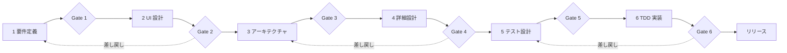

# 開発プロセス

## フェーズ共通の進め方（L3 ループ 1 周）
1. `docs/PROGRESS.md` の該当フェーズを `IN_PROGRESS` にする。
2. 対応するスキルを読み、上流成果物（入力）を全て読む。
3. テンプレートを埋めて成果物を作る。不明点は `Q-xx` として未決事項に記録し、まとめてユーザーに質問する。
4. スキルのセルフレビュー チェックリストを全て満たすまで修正する（検証可能なものは `./scripts/trace-check.sh` / `./scripts/verify.sh` で機械的に確認）。
5. ユーザーにレビュー依頼（成果物のリンク + 判断が必要な点のみ提示）。
6. 承認されたら `PROGRESS.md` を `APPROVED` にし、承認日時と次アクションを記録する。指摘があれば 3 に戻る。

## フェーズの入出力とゲート条件

| # | 入力 | 出力 | ゲート条件（機械的に確認できるもの） | ゲート条件（人が判断するもの） |
|---|---|---|---|---|
| 1 | ユーザーの構想 | requirements.md | 全 REQ に受入基準がある | スコープ・優先度が妥当 |
| 2 | requirements.md | ui-design.md, `@Preview` 試作, Roborazzi 画像 | 全 REQ(UI 関連) が SCR から参照される / `recordRoborazziDebug` 成功 | 見た目・操作性 |
| 3 | 1, 2 | architecture.md, ADR | 主要判断ごとに ADR がある | 設計方針 |
| 4 | 1〜3 | detailed-design.md | 全 DD が上流 ID を参照 | 実装可能性 |
| 5 | 1〜4 | test-design.md, journeys/*.xml | `trace-check.sh` で全 REQ が TC にマップ | 網羅性 |
| 6 | 1〜5 | 実装, テスト | `verify.sh` green / 全 TC がテストコードに存在 / 全 Journey PASS | 動作確認 |

## 差し戻しのルール
- 下流フェーズで上流の誤り・不足を見つけたら、作業を止めて上流ドキュメントの修正案を提示する。
- 承認済みドキュメントの変更は変更履歴に記録し、影響を受ける下流成果物を `PROGRESS.md` の「要再確認」に列挙する。
