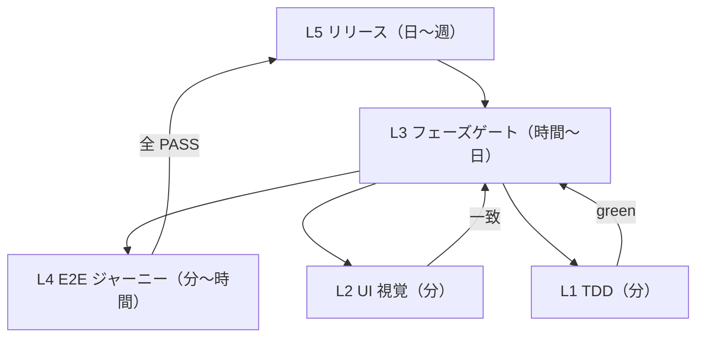

# フィードバックループ定義

各ループは **トリガ / 1 周の手順 / 検証器 / 終了条件 / 状態の保存先 / 脱出条件（行き詰まり時）** で定義する。

## L1: TDD ループ（内側・最速）
| 項目 | 内容 |
|---|---|
| トリガ | `test-design.md` の未実装 TC |
| 手順 | Red: テストを書き対象だけ実行し、**期待した理由で**失敗することを確認 → Green: 最小実装 → Refactor → `./scripts/verify.sh --fast` → コミット |
| 検証器 | `./gradlew :app:testDebugUnitTest --tests "<pattern>"`, `verify.sh --fast` |
| 終了条件 | 対象 TC が green かつ全テスト green |
| 状態 | git コミット、`PROGRESS.md` の TC チェックボックス |
| 脱出条件 | 同じ TC で 3 周しても green にならない → 詳細設計/テスト設計の前提を疑い、ユーザーに相談 |

## L2: UI 視覚ループ
| 項目 | 内容 |
|---|---|
| トリガ | Composable の追加・変更 |
| 手順 | `./gradlew recordRoborazziDebug` → `app/src/test/screenshots/*.png` を画像として閲覧 → `ui-design.md` の該当 SCR と比較 → 差異を修正。実機確認が必要なら `android run` → `android screen capture` / `android layout --pretty` |
| 検証器 | Roborazzi（`verifyRoborazziDebug`）、エージェントによる画像比較 |
| 終了条件 | 設計との差異なし、ベースライン PNG をコミット |
| 状態 | `app/src/test/screenshots/`（git 管理） |
| 脱出条件 | 設計が実装不能/不自然 → `ui-design.md` の修正をユーザーに提案 |

## L3: フェーズゲートループ
`docs/process/development-process.md` を参照。状態は `docs/PROGRESS.md`。

## L4: E2E ジャーニーループ
| 項目 | 内容 |
|---|---|
| トリガ | フェーズ 6 の機能単位完了時、リリース前 |
| 手順 | `journey-test` スキルに従い、エミュレータ起動 → `android run` → `journeys/*.xml` を 1 件ずつ評価 → JSON 結果を保存 |
| 検証器 | Android CLI（`android layout`, `android screen capture`, adb 入力） |
| 終了条件 | 全 Journey が PASSED |
| 状態 | `docs/05-test-design/journey-results/<date>-<JR-ID>.json` |
| 脱出条件 | FAILED → 原因の TC を追加して L1 に戻る（バグ再現テストを先に書く） |

## L5: リリースループ
| 項目 | 内容 |
|---|---|
| トリガ | `main` 上で `vX.Y.Z` タグを push |
| 手順 | `release` スキル / `RELEASE.md` に従う。CI が署名ビルド → Play 内部テスト → GitHub Release |
| 検証器 | GitHub Actions `release.yml`、Play Console |
| 終了条件 | 内部テストで配信、GitHub Release に APK |
| 状態 | GitHub Releases / Play Console / Issues |
| フィードバック | テスターの所感を GitHub Issue 化 → 次サイクルの要件（L3 フェーズ 1）へ |

## ハーネスによる強制
- **Stop フック（stop-gate）**: `app/` 等のソース変更後に `verify.sh` が成功していなければ、エージェントは作業を終了できない（最大 3 回差し戻し）。
- **PreToolUse フック（guard）**: 秘密情報アクセス・force push・`main` 直 push を拒否。
- **CI（ci.yml）**: PR と `main` で `verify.sh --ci` を実行。
